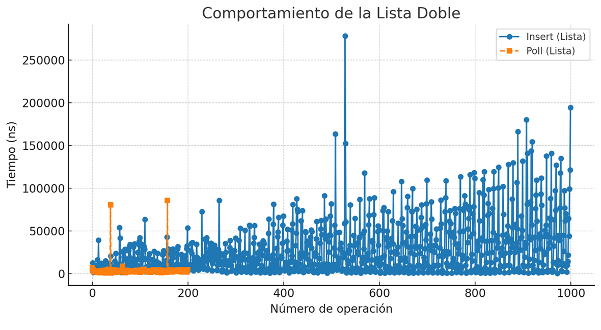
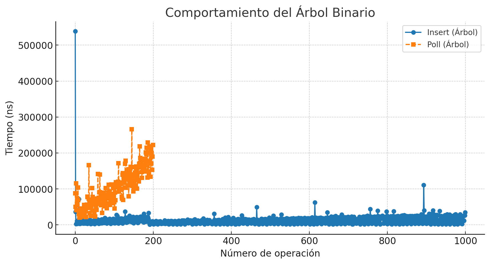

# Practica 0 - Alan Simei Paredes Vallejo, José Roberto Uribe Clemente
# Simulación de Triage Hospitalario

## Descripción del Proyecto

Este proyecto implementa una simulación de Triage hospitalario utilizando diferentes estructuras de datos en Java. Se comparan los tiempos de ejecución de operaciones básicas (inserción, extracción, búsqueda, etc.) sobre una **lista doblemente enlazada** y un **árbol binario**, generando resultados experimentales que luego se grafican y contrastan con el análisis teórico de complejidad.

## Archivos del Proyecto

* **Paciente.java** → Clase que representa un paciente con atributos básicos (nombre, edad, identificación, dirección, prioridad, tiempo de llegada). Implementa `Comparable` para ordenar según prioridad y llegada.
* **NodoDoble.java** → Nodo de la lista doblemente enlazada, contiene referencias al siguiente y anterior.
* **ListaDoble.java** → Implementación de una lista doblemente enlazada, con métodos de inserción, búsqueda y extracción.
* **ArbolBinario.java** → Implementación de un árbol binario de búsqueda (ABB) con inserción, búsqueda y eliminación.
* **Simulacion.java** → Clase principal que ejecuta la simulación. Genera pacientes, mide tiempos de ejecución para cada operación y guarda resultados en `resultados.csv`.
* **resultados.csv** → Archivo de salida con los tiempos de ejecución de las estructuras bajo diferentes operaciones y tamaños.
* **mainPruebas.java** → Programa de verificación de las estructuras de datos. Permite comprobar manualmente que los métodos de `ListaDoble` y `ArbolBinario` funcionan correctamente. **No forma parte de la simulación oficial**, pero se incluye como apoyo para validación.

## Instrucciones de Compilación y Ejecución

1. Compilar todos los archivos:

   ```bash
   javac *.java
   ```

2. Ejecutar la simulación:

   ```bash
   java Simulacion
   ```

3. Se generará el archivo `resultados.csv`, que puede usarse para graficar en Python, R, Excel u otra herramienta.

## Gráficas de Resultados Experimentales

### Lista Doble

La operación **Insert** muestra un crecimiento casi lineal en el tiempo de ejecución, lo cual concuerda con la complejidad esperada **O(n)**. La operación **Poll** se mantiene más estable.



### Árbol Binario

La operación **Insert** es más estable y cercana a **O(log n)**, mientras que **Poll** muestra mayor variabilidad a medida que crece el número de elementos.



## Discusión

* **Lista Doble:** Teóricamente, insertar en una lista puede costar O(1) si se hace al inicio o final, pero en esta implementación el ordenamiento por prioridad provoca un costo más cercano a O(n). Los resultados experimentales confirman este comportamiento.
* **Árbol Binario:** En el mejor de los casos, insertar y buscar es O(log n), aunque en casos degenerados puede ser O(n). Las gráficas muestran una tendencia mucho más eficiente que la lista, validando la teoría.
* **Comparación:** El árbol binario resulta superior en operaciones de inserción y búsqueda, mientras que la lista puede ser competitiva en extracción secuencial. Los resultados empíricos concuerdan con el análisis Big-O, aunque se observa cierta dispersión por factores como constantes ocultas, manejo de memoria y caché.

## Notas Adicionales

* Se recomienda correr múltiples simulaciones y promediar resultados para mayor robustez.
* Se puede añadir medición de desviación estándar y barras de error en las gráficas.
* Para versiones de Java < 15, evitar el uso de *text blocks* (`"""`), sustituyéndolos por concatenaciones de cadenas tradicionales.

