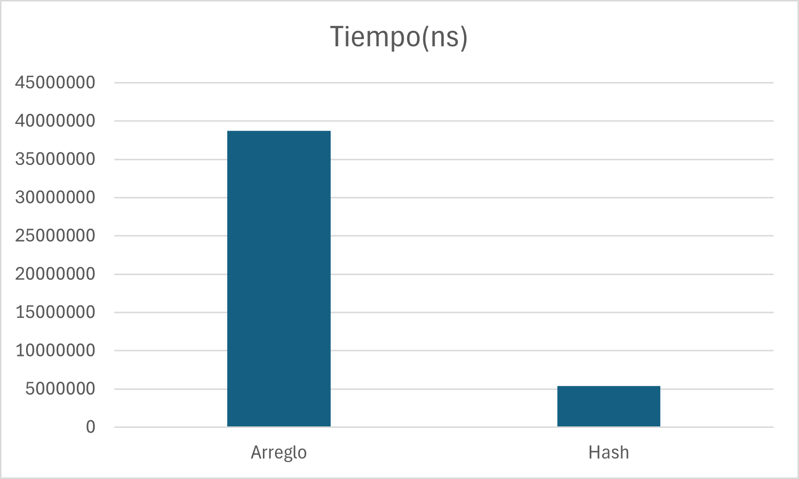

# Práctica 1 – Tablas de Hash vs Arreglo

**Autores:**  
- Alan Simei Paredes Vallejo  
- José Roberto Uribe Clemente  

## Descripción del Proyecto

Este proyecto implementa una simulación para detectar pacientes duplicados en un centro de salud a partir de sus estudios de laboratorio. Cada paciente está descrito por **10 valores enteros**, y el sistema permite comparar dos enfoques para almacenamiento y búsqueda:

1. **Arreglo lineal**  
2. **Tabla Hash propia**

El objetivo es medir los tiempos de ejecución y analizar la eficiencia de cada estructura de datos.

## Archivos principales

- **Paciente.java** → Clase que representa a un paciente con 10 datos enteros. Incluye `equals` y `hashCode` para comparación correcta.
- **ArregloPacientes.java** → Maneja pacientes en un arreglo. Implementa dos métodos para encontrar duplicados:
  - `hayDuplicadosLineal()` → Comparación estrictamente lineal O(n²).
  - `hayDuplicados()` → Usando `HashMap` para conteo.
- **ListaDoble.java** → Lista doblemente ligada para manejar colisiones en la tabla hash.
- **NodoDoble.java** → Nodo genérico usado en la lista doble.
- **TablaHash.java** → Implementación de tabla hash con encadenamiento. Carga pacientes desde archivo y detecta duplicados.
- **GeneradorPacientes.java** → Genera archivo `pacientes.txt` con datos aleatorios y duplicados.
- **Pruebas.java** → Ejecuta pruebas sobre las estructuras y genera archivo `resultados.csv` con tiempos y número de duplicados.

## Flujo del proyecto

1. **Generación de datos**  
   Se ejecuta `GeneradorPacientes.java`, que crea el archivo `pacientes.txt` con `n` pacientes.  
   - La mitad son aleatorios.  
   - La otra mitad contiene duplicados de los primeros.

2. **Ejecución de pruebas**  
   Se corre `Pruebas.java`, que:
   - Carga pacientes en un **Arreglo**.
   - Detecta duplicados de forma lineal y con hash propio.  
   - Mide tiempos de ejecución con `System.nanoTime()`.
   - Guarda resultados en `resultados.csv`.

3. **Visualización de resultados**  
   El archivo `resultados.csv` puede graficarse en Excel, Python o cualquier software estadístico.  
   Ejemplo de gráfico de barras comparando tiempo en nanosegundos entre estructuras:  

   

## Resultados esperados

- El **arreglo lineal** tarda mucho más porque compara cada paciente con todos los demás (**O(n²)**).  
- La **tabla hash** encuentra duplicados en tiempo cercano a **O(n)** gracias al hashing y encadenamiento.  

## 🚀 Ejemplo de salida (consola)

```text
se encontraron 5000 pacientes idénticos (Arreglo Lineal)
se encontraron 5000 pacientes idénticos (Hash)
Pruebas completadas. Resultados en resultados.csv
```

## 📈 Ejemplo de `resultados.csv`

```csv
Estructura,Tiempo(ns),Duplicados
ArregloLineal,52156600,5000
Hash,7019000,5000
```

## 🔧 Requerimientos

- **Java JDK 8+**
- Editor/IDE como IntelliJ, Eclipse o VS Code

## ▶️ Ejecución

1. Compilar todas las clases:
   ```bash
   javac *.java
   ```

2. Generar archivo de pacientes:
   ```bash
   java GeneradorPacientes
   ```

3. Ejecutar pruebas:
   ```bash
   java Pruebas
   ```

4. Abrir `resultados.csv` y graficar.

---


