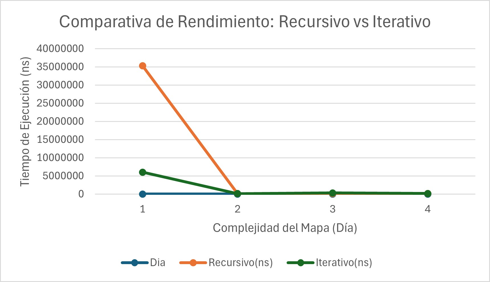

# Práctica 3: Recursión

**Autores:** 
- Alan Simei Paredes Vallejo  
- José Roberto Uribe Clemente  

## 🔧 Descripción del Proyecto

Este proyecto implementa y compara dos soluciones algorítmicas para resolver un problema de planificación de rutas de recolección de paquetes, representadas como árboles binarios. El objetivo es comparar el rendimiento de un **enfoque recursivo** contra uno **iterativo (usando una Pila)** para recorrer los árboles, calcular el peso total y determinar la ruta.

Se miden los tiempos de ejecución de ambas implementaciones sobre varios mapas de complejidad creciente, y los resultados se exportan a un archivo CSV para su posterior análisis y visualización.

## Archivos del Proyecto

* `ArbolBinarioEstricto.java` → Modela el mapa de recolección y contiene la lógica de los recorridos recursivo e iterativo.
* `NodoDoble.java` → Nodo genérico para el árbol binario.
* `Parada.java` → Encapsula el peso a recolectar en las hojas del árbol.
* `Pila.java` → Estructura de Pila explícita usada por el algoritmo iterativo.
* `PruebasLaboratorio3.java` → Clase principal que ejecuta las pruebas, mide los tiempos y genera `resultados_laboratorio3.csv`.
* `mapas.txt` → Archivo de entrada con los mapas en formato de árbol.
* `resultados_laboratorio3.csv` → Salida con los datos de rendimiento para cada algoritmo.
* `GraficaLab3.jpg` → Visualización de los resultados de rendimiento.

## ▶️ Instrucciones de Compilación y Ejecución

1.  **Compilar todos los archivos:**
    ```bash
    javac PR2/*.java
    ```

2.  **Ejecutar las pruebas:**
    ```bash
    java PR2.PruebasLaboratorio3
    ```

3.  El programa imprimirá los resultados en la consola y generará `resultados_laboratorio3.csv`.

## 📈 Gráfica de Resultados Experimentales

La gráfica compara los tiempos de ejecución de ambos algoritmos. El eje X representa la complejidad creciente del mapa y el eje Y el tiempo en nanosegundos.



## 🔬 Discusión

* **Análisis Teórico:** Ambos algoritmos, al tener que recorrer cada nodo y arista del árbol, presentan una complejidad temporal teórica de **O(n)**, donde *n* es el número de nodos. Por lo tanto, se espera que su rendimiento sea lineal y muy similar.

* **Resultados Experimentales:** La gráfica confirma la teoría. Los tiempos de ejecución para ambas versiones son prácticamente idénticos y crecen de forma proporcional a la complejidad del árbol. Las pequeñas variaciones observadas pueden atribuirse a factores como la optimización del compilador JIT (Just-In-Time) de Java y la sobrecarga mínima de las llamadas a métodos.

* **Comparación:**
    * La **versión recursiva** es más concisa, pero depende de la pila de llamadas del sistema, lo que podría suponer un riesgo de `StackOverflowError` en árboles extremadamente profundos.
    * La **versión iterativa** gestiona su propia Pila en la memoria heap, eliminando el riesgo anterior, aunque su código puede ser ligeramente más verboso.

* **Conclusión:** Para los casos de prueba de esta práctica, no existe una ventaja de rendimiento significativa entre un enfoque y otro. La elección dependería de la legibilidad del código y de los requisitos de robustez ante entradas de datos extremas.