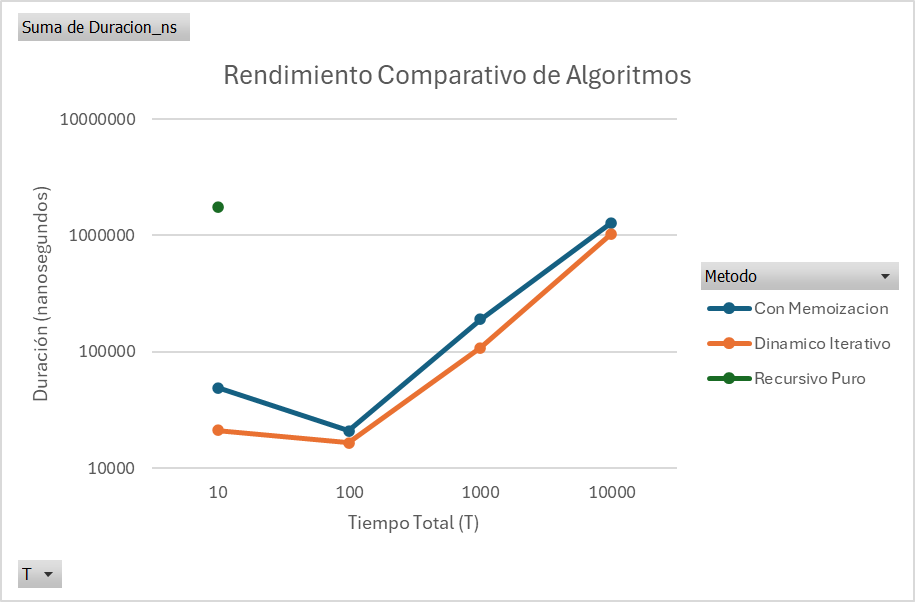

# Laboratorio 3 - Alan Simei Paredes Vallejo, José Roberto Uribe Clemente

## Análisis de Algoritmos: Programación Dinámica

### Descripción del Proyecto

Este proyecto implementa y compara tres enfoques algorítmicos para resolver el "problema de las hamburguesas". Se analiza una solución recursiva de fuerza bruta contra dos versiones optimizadas utilizando **memoización** (Top-Down) y **programación dinámica** (Bottom-Up). El objetivo es medir y contrastar los tiempos de ejecución para demostrar la ganancia de eficiencia al evitar el recálculo de subproblemas superpuestos.

### Archivos del Proyecto

* `Resultado.java` → Clase simple para encapsular los resultados de cada prueba (cantidad de hamburguesas y tiempo usado).
* `ComparacionHamburguesas.java` → Contiene la lógica central de los tres algoritmos implementados: `solveRecursivoPuro`, `solveConMemoizacion` y `solveDinamico`.
* `Pruebas.java` → Clase principal que orquesta los experimentos. Ejecuta cada algoritmo bajo diferentes casos de prueba, mide los tiempos de ejecución con `System.nanoTime()` y guarda los datos en un archivo de salida.
* `resultados_hamburguesas.csv` → Archivo CSV generado por `Pruebas.java` con los datos de rendimiento (método, parámetros de entrada, tiempo en nanosegundos).
* `image.png` → Gráfica de líneas que visualiza los resultados del archivo CSV para el análisis experimental.

### Instrucciones de Compilación y Ejecución

1.  Asegurarse de que todos los archivos `.java` estén en la misma carpeta (o en una carpeta `src`).
2.  Compilar todos los archivos:
    ```bash
    javac *.java
    ```
3.  Ejecutar el programa de pruebas:
    ```bash
    java Pruebas
    ```
    Se generará el archivo `resultados_hamburguesas.csv` en la carpeta `PR3/` (o `data/`, según la configuración final) y se mostrarán los resultados en la consola.

### Gráfica de Resultados Experimentales



### Discusión

#### Análisis Teórico
La complejidad de los algoritmos se analiza en función del tiempo total `T`:
* **Recursivo Puro:** Presenta una complejidad temporal de **O(2^T)**. Sin un mecanismo de guardado, el algoritmo explora múltiples ramas redundantes del árbol de recursión, recalculando los mismos valores para un tiempo `t` restante una y otra vez.
* **Memoización y Dinámico:** Ambos algoritmos optimizados tienen una complejidad temporal de **O(T)**. Gracias al almacenamiento de resultados intermedios (en un arreglo de memoización o una tabla de DP), cada subproblema para un tiempo `t` se calcula una sola vez. Esto reduce el crecimiento exponencial a uno lineal.

#### Resultados Experimentales
La gráfica de resultados valida de manera contundente el análisis teórico. Se observa que la línea del algoritmo recursivo puro crece de forma exponencial, volviéndose intratable para valores de `T` relativamente pequeños (en nuestro caso, alrededor de T=35). En contraste, las líneas de los algoritmos con memoización y dinámico muestran un crecimiento lineal y controlado, manejando valores de T hasta 10,000 sin dificultad. El uso de una **escala logarítmica** en el eje vertical fue indispensable para poder visualizar en la misma gráfica el rendimiento de los tres métodos.

#### Comparación
* **Versión Recursiva:** Es la más intuitiva de implementar, pero su ineficiencia la hace inviable para aplicaciones prácticas.
* **Versión con Memoización:** Mantiene la estructura recursiva pero añade un caché (el memo) para evitar recálculos. Es un puente directo entre la fuerza bruta y la programación dinámica.
* **Versión Dinámica (Iterativa):** Es la más eficiente en la práctica, ya que elimina la sobrecarga (overhead) de las llamadas recursivas al construir la solución de forma iterativa desde el caso base.

#### Conclusión
El experimento demuestra el poder de la programación dinámica y la memoización como técnicas de optimización. Al identificar y resolver subproblemas superpuestos una sola vez, es posible transformar un algoritmo de complejidad exponencial en uno de complejidad lineal, haciendo que el problema sea resoluble para entradas de datos significativamente más grandes. Los resultados empíricos concuerdan directamente con el análisis de complejidad Big-O, confirmando la validez del modelo teórico.