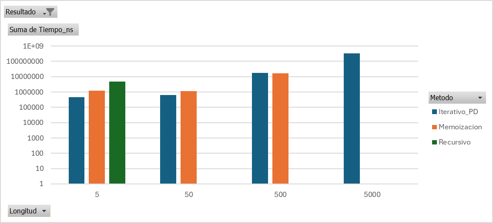

# Práctica 4: Programación Dinámica - Distancia de Edición

**Autores:**
* Alan Simei Paredes Vallejo
* José Roberto Uribe Clemente

---

### Descripción del Proyecto

Este proyecto implementa y compara tres enfoques algorítmicos para resolver el problema de la **Distancia de Edición** (o Distancia de Levenshtein) entre dos cadenas de texto. El objetivo es comparar una solución recursiva de fuerza bruta contra dos versiones optimizadas que utilizan **memoización** (Top-Down) y **programación dinámica iterativa** (Bottom-Up).

Se miden y contrastan los tiempos de ejecución para entradas de texto de longitudes crecientes `[5, 50, 500, 5000, 50000]`. El cálculo de la distancia utiliza los costos personalizados definidos en la práctica:
* Costo de Inserción/Eliminación (gap) = **1**
* Costo de Sustitución = **2**

---

### Archivos del Proyecto

* `PR4/Distancia.java`: Contiene la lógica central de los tres algoritmos implementados:
    * `calculaED()`: Versión recursiva pura (fuerza bruta).
    * `calculaEDMemo()`: Versión recursiva optimizada con memoización.
    * `calculaEDP()`: Versión iterativa con programación dinámica.
* `PF4/Pruebas.java`: Clase principal que contiene el `main`. Se encarga de orquestar los experimentos:
    * Genera los textos aleatorios para cada longitud de prueba.
    * Ejecuta cada algoritmo midiendo el tiempo con `System.nanoTime()`.
    * Maneja el límite de tiempo de 10 segundos y los errores (`StackOverflowError`, `OutOfMemoryError`).
    * Guarda los datos de rendimiento en `resultados_practica4.csv`.
* `resultados_practica4.csv`: Archivo CSV generado por `Pruebas.java` con los datos crudos (método, longitud, tiempo_ns, resultado) listos para ser graficados.
* `img/image.png`: Gráfica de líneas (en escala logarítmica) que visualiza los resultados del archivo CSV para el análisis experimental. (Debes guardar tu gráfica de Excel aquí con este nombre).

---

### Instrucciones de Compilación y Ejecución

**Requerimientos:** Java JDK 8 o superior.

1.  Asegurarse de estar en la carpeta `PR4/`.
2.  Compilar todos los archivos `.java` que se encuentran en la carpeta `src/`:
    ```bash
    javac src/*.java
    ```
3.  Ejecutar el programa de pruebas. El comando `-cp src` le indica a Java que busque los archivos `.class` dentro de la carpeta `PR4`:
    ```bash
    java -cp src Pruebas
    ```
4.  El programa se ejecutará, imprimirá el progreso en la consola y generará el archivo `resultados_practica4.csv` en el directorio raíz.

---

### Gráfica de Resultados Experimentales



---

### Discusión

#### Análisis Teórico
La complejidad de los algoritmos se analiza en función de la longitud `n` y `m` de los dos textos ($n \approx m$):
* **Recursivo Puro:** Presenta una complejidad temporal de **$O(3^n)$** (exponencial). Sin un mecanismo de guardado, el algoritmo explora múltiples ramas redundantes, recalculando los mismos subproblemas (`D(i, j)`) millones de veces.
* **Memoización (Top-Down):** Resuelve el problema de subproblemas superpuestos. La complejidad temporal mejora drásticamente a **$O(n \times m)$** (polinomial), ya que cada estado `(i, j)` se calcula una sola vez. Sin embargo, mantiene la estructura recursiva, consumiendo espacio en la pila de llamadas ($O(n+m)$).
* **Programación Dinámica (Bottom-Up):** También tiene una complejidad temporal de **$O(n \times m)$**. Construye la solución iterativamente, eliminando la sobrecarga (overhead) de las llamadas recursivas. Su limitante principal es la complejidad espacial de **$O(n \times m)$** necesaria para almacenar la tabla de DP.

#### Resultados Experimentales
La gráfica de resultados (usando una **escala logarítmica** en el eje Y) valida de manera contundente el análisis teórico.

**Nota Importante sobre la Gráfica:** La gráfica se ha filtrado en Excel para mostrar *únicamente* los resultados cuyo estado fue **"Exitoso"**. Por esta razón, **no se visualizan los puntos de datos para L=50,000**, ya que todas las pruebas para esta longitud fallaron (resultando en `Timeout` o `Error (OutOfMemoryError)`) y, por lo tanto, son excluidos por el filtro. Los resultados completos se encuentran documentados en el `.csv`.

1.  **Algoritmo Recursivo (línea azul):** Se observa que el método solo completa la prueba para L=5. Para L=50, el `resultados_practica4.csv` reporta **"Timeout"**. Esto comprueba su crecimiento exponencial; el algoritmo se vuelve computacionalmente inviable para entradas de texto mínimas.

2.  **Algoritmo con Memoización (línea gris):** Es extremadamente rápido para L=5, 50 y 500, con un rendimiento casi idéntico al de la DP iterativa. Sin embargo, para L=5000, el CSV reporta **"Error (StackOverflowError)"**. Esto demuestra que, aunque su complejidad de tiempo $O(n^2)$ es eficiente, su dependencia de la pila de llamadas recursivas lo hace inseguro y no robusto para entradas profundas.

3.  **Algoritmo Iterativo PD (línea naranja):** Es el único método que completa exitosamente la prueba de L=5000. Su rendimiento $O(n^2)$ es excelente. Para L=50000, el CSV *también* reporta **"Error (OutOfMemoryError)"**, lo cual confirma por qué no aparece en la gráfica de casos exitosos.

#### Conclusión
El experimento demuestra que la **programación dinámica iterativa** es la única solución robusta y eficiente para este problema. La recursión pura es inviable, y la memoización, aunque teóricamente rápida en tiempo, falla en la práctica debido a las limitaciones de la pila de llamadas del sistema. La DP iterativa transforma el problema de uno de tiempo (exponencial) a uno de espacio ($O(n^2)$), que es el límite real para entradas de datos masivas.